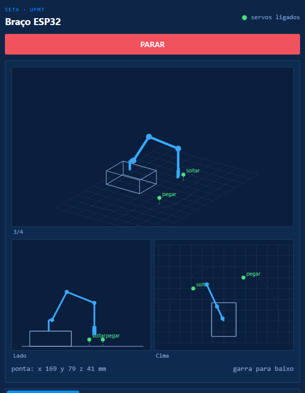

# Braço SETA — braço robótico com cinemática inversa no ESP32

Firmware de um braço robótico de servos controlado por um **ESP32**, com cinemática direta e
inversa rodando no próprio microcontrolador, calibração guiada, pontos ensinados e a tarefa
**"pegar e levar"**, tudo operado por uma página web servida pelo ESP32 (Wi-Fi em modo ponto de
acesso). Projeto da equipe SETA (UFMT).

## O que o firmware faz

- **Cinemática (`kin.h`):** direta e inversa com a garra sempre apontando para baixo, e o
  mapeamento entre ângulo de servo e ângulo de junta. Medidas do CAD: ombro a 97,5 mm da mesa,
  braço de 120,0 mm, antebraço de 119,7 mm e punho até os dedos de 119,2 mm.
- **Movimento (`motion.h`, `tasks.h`):** rampa de velocidade nas juntas, trajetória em linha reta e
  a sequência pegar e levar entre dois pontos ensinados, com altura de aproximação.
- **Calibração em 8 passos:** pela página, com esquadro e nível, para corrigir a montagem dos servos.
- **Página web (`pagina.html`):** desenho do braço em três vistas, sliders por junta, movimento em
  XYZ com passo ajustável, pontos ensinados, tarefa e calibração.
- **Hardware:** ESP32 Dev Module, driver de servos PCA9685 (I2C) e servos MG996R.

A cinemática foi validada no PC antes de ir para o braço: a pose do CAD dá a mesma posição da
ponta que o Fusion 360, e a ida e volta da cinemática inversa erra menos de 0,001 mm em 2082 pontos.

## Como rodar

1. Abra `firmware-v2-v3-e-testes/braco_esp32_ik_v3/braco_esp32_ik/braco_esp32_ik.ino` na Arduino IDE,
   com a placa **ESP32 Dev Module** e a biblioteca **Adafruit PWM Servo Driver**.
2. Grave, conecte o celular ou o computador na rede Wi-Fi criada pelo braço e abra
   http://192.168.4.1.
3. Siga o roteiro de teste do `LEIA-ME.md` da mesma pasta: ligar os servos, calibrar, testar o
   movimento em XYZ, ensinar os pontos e só então rodar a tarefa.

Se algo não funcionar, os sketches de `testes_braco_esp32/testes/` isolam cada parte em ordem
(I2C com o PCA9685, servos pela serial, partida com Wi-Fi e controle pela página).

## Estrutura

| Pasta | Conteúdo |
|---|---|
| `firmware-v2-v3-e-testes/braco_esp32_ik_v3/` | versão final do firmware com cinemática inversa |
| `firmware-v2-v3-e-testes/braco_esp32_ik_v2/` | versão anterior |
| `firmware-v2-v3-e-testes/testes_braco_esp32/` | testes por partes (T1 a T4) |
| `firmware-v2-v3-e-testes/BraçoEsp/firmware/` | firmwares anteriores (com e sem cinemática), versão para ESP8266 e a pasta `pc_camera` |
| `mecanica-e-firmware-v1/` | primeira versão do firmware e as peças próprias em STEP (base nova e tampa da garra) |
| `logo/` | logotipo da equipe SETA |

A mecânica parte do braço "DIY Arduino Robot Arm" (FABRI creator), cujo modelo não é distribuído aqui.
